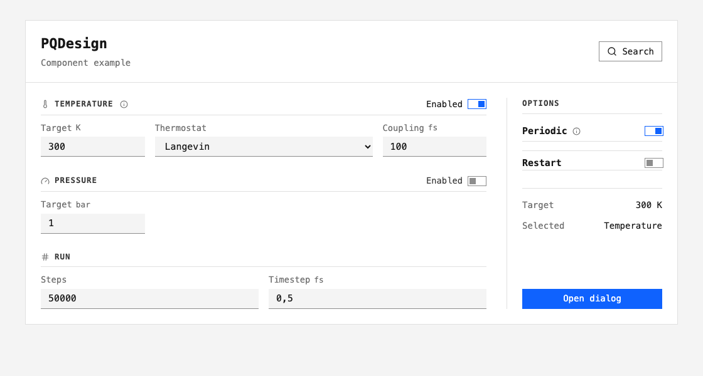

#  PQDesign

Shared tokens, React controls and terminal presentation for the PQ tools.



The example uses `@molarverse/pq-design` 0.1.2. Fields carry labels and units;
the application owns state, validation and layout.

```bash
npm install "https://github.com/MolarVerse/PQDesign/releases/download/v0.2.0/molarverse-pq-design-0.2.0.tgz"
```

```tsx
import "@molarverse/pq-design/styles.css";
import { Field, Toggle, Modal } from "@molarverse/pq-design";
```

| Import | Use |
| --- | --- |
| `styles.css` | Shared controls and page defaults |
| `app-header.css` | Standalone header layout for apps with custom page styles |
| `search-trigger.css` | Standalone search-button styles, for apps that do not import the full control set |
| `tokens.css` | Own controls or documentation theme |
| `tokens.json` | Design values as data |
| `terminal.py` | Shared Python wordmarks, help and event logs |

Use `AppHeader` for the shared logo, title, search and actions layout. Keep mode
switchers and health checks in each app. Use `HeaderStatus` for its check list,
`HelpButton` and `HelpPanels` for help and keyboard shortcuts, and
`AutoRefreshButton` next to the data it controls.

Use `SearchTrigger` for a desktop search bar that becomes a 44 px magnifier on
phones. The app supplies the name, shortcut hint, open state, and popup. Use
`mobile="bar"` when the mobile layout has a dedicated search row.

Node.js 20+; React and React DOM 19+; Lucide React 0.400+. Commit the archive
URL and lockfile. Use the [visual guide](https://molarverse.github.io/PQDesign/getting-started.html)
and [reference](https://molarverse.github.io/PQDesign/reference.html) for
control properties, tokens and documentation styling.

Python applications vendor `python/pq_terminal.py` unchanged and require Rich
13+ and rich-argparse 1.7+. See the [terminal guide](https://molarverse.github.io/PQDesign/terminal.html).

[Source](https://github.com/MolarVerse/PQDesign) | [Releases](https://github.com/MolarVerse/PQDesign/releases) | [MIT license](LICENSE)
